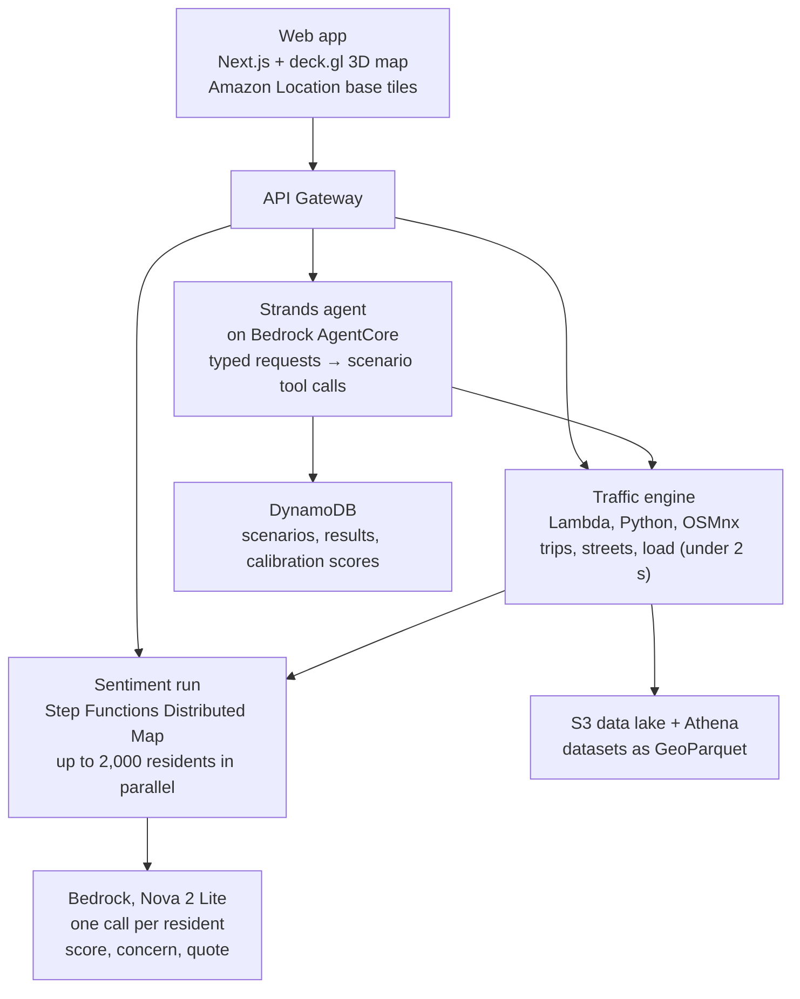

# CitySim Detroit — Project Scope

Nov 14, 2026 · BuilderWars Hackathon (AWS Student Builder Group at Wayne State University)

## Overview

CitySim Detroit predicts two things for any proposed change in a Detroit neighborhood: **how much traffic it adds to each street** and **how residents will feel about it**. A user picks a scenario (400 apartments, a drone delivery hub, a bus cut), places it on a 3D map of any of Detroit's seven City Council districts, and gets street-by-street load numbers plus a forecast of support and opposition by neighborhood, with quotes from AI residents.

**Who it's for:** city planners, City Council staff, community groups, and developers who want to know before a public hearing what traffic and opposition to expect.

**What makes it different:** every number is traceable to a public dataset or a published rate, and the sentiment forecast is anchored to real Detroit survey results, not just what an AI model guesses.

**Success at BuilderWars (Sunday noon):**

- 6 scenarios that run end to end on real data in any district, plus 2 that are pre-computed
- Traffic load for every counted street, before and after
- A sentiment forecast that is checked against at least one real poll result
- A live demo under 4 minutes, built on Bedrock, a Strands agent, Step Functions, Lambda and DynamoDB
- Targets the AWS track and the overall top 3

## District coverage

The user picks up to 4 of Detroit's seven City Council districts, and CitySim builds those 4: a real 3D model, their data layers, and 500 AI residents each, 2,000 in all. Districts average about 91,000 residents ([Axios](https://www.axios.com/local/detroit/2024/01/24/residents-fear-council-redistricting-could-tear-apart-neighborhoods)); boundaries come from the 2026 council map ([Detroit Open Data](https://detroitdata.org/dataset/detroit-city-council-districts-2026)).

**What "build" means, and what's pre-done so it's instant**

| Step | When it runs | Cost |
| --- | --- | --- |
| Clean and tag all datasets for all 7 districts | Once, Saturday night | Free (Python + Athena) |
| Generate 500 resident profiles per district from census data, 3,500 total | Once, Saturday night | Free: census math, no AI calls |
| Prepare 3D buildings for all 7 districts as map tiles | Once, Saturday night | Free |
| User selects 4 districts | Live | Loads pre-built tiles and profiles in seconds |
| Run a scenario | Live | 2,000 Bedrock calls (500 × 4), run in parallel |

Resident profiles come from census math alone. The AI is only called when residents react to a scenario, so building districts costs nothing and only scenario runs use Bedrock.

**Why 4 districts sells the demo:** run the same drone route or housing project in Corktown and in a residential east-side district, side by side. Support, top concern and street load change because the residents and streets are different. That shows judges the model responds to real local data instead of giving one generic answer.

**Scenarios that cross a boundary:** results are reported per district, since each district has its own council member.

## Realistic 3D model

Yes, the districts can be modeled realistically from real data. Use two layers: an accurate building layer that the simulation colors and clicks, plus an optional photorealistic view for the demo.

| Layer | What it shows | Data | Notes |
| --- | --- | --- | --- |
| **Core: real buildings** | Every building in the selected districts, real outline and real height, colored by impact | [SEMCOG Building Footprints 2024](https://geo.btaa.org/catalog/c9bd1139cb15497084c328315a2c0c84_2) (stories, lidar-measured height) + [Overture Maps buildings](https://registry.opendata.aws/overture/) (hosted on AWS) | Free. Each building is clickable and links to its parcel and residents |
| Optional: photorealistic view | Textured 3D city like Google Earth, with CitySim layers draped on top | [Google Photorealistic 3D Tiles](https://deck.gl/docs/developer-guide/base-maps/using-with-3d-tiles) in deck.gl | Needs a Google Maps API key and has usage costs. Confirm Detroit coverage before relying on it |
| Overlays | Streets colored by load, drone flight bands, resident dots, scenario buildings | CitySim engines | Same in both views |

**Why the core layer can be accurate:** SEMCOG's footprint layer records the number of stories and a [median height from lidar](https://geonet.esri.com/ccqpr47374/attachments/ccqpr47374/arcgis-cityengine-questions/6558/1/BuildingsDocumentation111015.pdf) for each building. Overture's heights also come from [USGS lidar](https://overturemaps.org/resources/technical-spotlights). Detroit is mostly low-rise: [397,744 of its 419,882 buildings are under 2 stories](https://detroitography.com/2016/04/01/map-detroit-building-heights/). So getting heights right mostly means getting houses right, and both datasets cover them.

**Pulling the data from AWS is itself a talking point:** Overture publishes its buildings as GeoParquet on S3, so the build reads it with Athena directly and clips it to the 4 selected districts.

## Scenario library

Every scenario uses one engine with the same three steps: convert the change into **trips added or removed**, put those trips on **specific streets**, then ask **survey-grounded AI residents** how they feel. Ship 6 scenarios live and 2 pre-computed; the rest are stretch goals.

| Scenario | User sets | Traffic method | Sentiment anchored to | Build status |
| --- | --- | --- | --- | --- |
| Apartments / housing | units, floors, site | ITE code 221: 4.54 car trips per unit per day, 0.39 at evening peak ([rates](https://discover.pbc.gov/engineering/traffic/PDF/Traffic%20Documents/Trip_Generation_Rates.pdf)) | DMACS housing-cost and neighborhood questions | Live (done in mockup) |
| **Drone delivery hub / corridor** | hub site, flights per day, share of van deliveries replaced, flight path | Delivery-van trips removed = packages moved to drones ÷ packages per van trip (user input); flight path drawn as a noise band | Drone-delivery polls (Christiansburg, VA: 87% positive; UK: 23% support), age gap | Live |
| Road diet | lanes removed on a segment | Same traffic, fewer lanes: Michigan Ave 5 → 3 lanes takes load from 0.32 to 0.64 | DMACS traffic and safety questions | Live |
| Bus route cut or frequency change | route, trips per hour | Riders who lose a route shift partly to cars; job access recomputed from GTFS | DMACS transit-use questions | Live |
| Grocery store | square footage, site | ITE code 850: 93.84 trips per 1,000 sq ft per day ([rates](https://files.ceqanet.lci.ca.gov/217302-3/attachment/it9Prc7V4pZceNolKLv3PMYQgfbMQ3hEtOqaIlspIoh-DejQ6SWdagVQl1kV-doZziYduylG-kdmCvnk0)) | DMACS food-access and neighborhood questions | Live |
| Rezoning | parcels, new zoning class | Maximum allowed units under the new zone → housing method | DMACS development and displacement questions | Live |
| Data center | megawatts or square footage | ITE data center rate (low traffic); add construction trucks as a separate phase | Local news and public comment themes | Pre-computed |
| Stadium / event venue | seats, events per year | Event-day surge on top of daily traffic | Public comment themes | Pre-computed |
| Autonomous shuttle | route, vehicles, hours | Car trips replaced by shuttle riders (user input) | Autonomous-vehicle polls | Stretch |
| Protected bike lanes | segment, lanes converted | Road-diet method plus a user-set share of drivers who switch to bikes | DMACS safety questions | Stretch |

**Why lead with drones:** Corktown sits inside Michigan Central's Advanced Aerial Innovation Region, which [covers a 3-mile radius around Michigan Central](https://michigancentral.com/?p=3782). Aerialoop already flies a cargo drone route [beyond visual line of sight from Newlab's roof](https://michigancentral.com/?p=22696), the building you're demoing in. A drone scenario is a real decision this neighborhood faces now.

## AI scenario chat

Users don't pick from preset scenarios. They type what they want to happen, and a Strands agent turns it into a structured scenario that the traffic and sentiment engines run. The AI interprets the request. Only the engines produce numbers, so the chat never invents traffic counts or poll results.

1. **User types a request:** "Turn the vacant lot at Michigan and 14th into a 6-story apartment building with a ground-floor grocery."
2. **Agent parses it with tools:** `geocode` (Amazon Location), `find_parcels`, `lookup_trip_rate` (ITE table), and action tools: `add_building`, `modify_road`, `close_street`, `change_transit`, `add_drone_route`, `rezone`.
3. **Agent writes a scenario spec** (actions, location, districts, assumptions, confidence).
4. **Confirmation card in the chat:** "Here's what I understood: 180 apartments + 15,000 sq ft grocery on parcel X." Buttons: Edit, Run. This catches misreadings before a run, and shows judges the AI's reasoning.
5. **Run:** traffic engine → street loads → each resident's personal impact → sentiment → map and results update.
6. **Follow-ups edit the spec:** "make it 4 stories," "also cut a lane on Michigan," "compare with the first version."

```json
{
  "actions": [
    {"type": "add_building", "parcel": "<parcel id>", "uses": [
      {"use": "apartments", "ite_code": 221, "units": 180},
      {"use": "grocery", "ite_code": 850, "sqft": 15000}]}
  ],
  "districts": [6],
  "assumptions": ["unit count inferred from 6 floors x lot size"],
  "confidence": "medium"
}
```

**Rules that keep it credible**

- A use with no trip rate in the table (a skate park, a mural) gets the nearest code, a **low confidence** label, and its assumption listed.
- Every scenario spec is saved to DynamoDB, so any run can be replayed and compared.
- Off-topic or unsafe requests get a polite refusal.
- Before the demo, write and test **5 demo prompts** end to end. If the agent misreads live, fall back to one of them.

**UI change:** the scenario list on the left becomes a chat panel with the confirmation card and run history. The map and results panel stay the same.

## Data catalog

Load 17 public datasets in four layers: the city itself, traffic, resident opinion, and scenario rates. Load every dataset citywide, tag each row with its council district, then build 3D detail district by district, starting with Corktown + Southwest. Two more datasets support this: ACS microdata (PUMS) for Detroit as the seed for AI residents, and the 2026 City Council district boundaries for tagging.

**City base**

| Dataset | What it gives the model | Detail | Years | Source |
| --- | --- | --- | --- | --- |
| Parcels | Lot shapes, land use, vacancy, owner type | Every parcel, updated daily | current | [Detroit Open Data](https://detroitdata.org/dataset/parcels) |
| Zoning | Allowed use and density per parcel | Every parcel | 2021 categories | [Detroit Open Data](https://detroitdata.org/dataset/zoning) |
| SEMCOG + Overture buildings, OSM roads | 3D building outlines, street network for routing | Building level | current | SEMCOG, Overture, OSM via OSMnx |
| Census ACS 5-year | Age, income, household size, cars per household, commute mode | Census tract / block group | 2019–2023 | Census API |
| LEHD LODES 8 | Where residents work and where workers live | Census block pairs | 2002–2023 | [Census LEHD](https://lehd.ces.census.gov/data) |

**Traffic**

| Dataset | What it gives the model | Detail | Years | Source |
| --- | --- | --- | --- | --- |
| Traffic volumes (AADT) | Cars per day, lanes, speed limit per road segment | Segment | 2020 loaded; newer years to add | [City of Detroit / MDOT](https://detroitdata.org/dataset/traffic-volumes) |
| SEMCOG traffic volume | Same measure for all federal-aid roads in SE Michigan | Segment | yearly | [SEMCOG](https://maps.semcog.org/trafficvolume) |
| Traffic crashes | Crash location, severity, injuries; safety baseline per street | Point | 2011–2024 | [Detroit Open Data](https://services2.arcgis.com/qvkbeam7Wirps6zC/arcgis/rest/services/Traffic_Crashes/FeatureServer) |
| DDOT GTFS | 37 bus routes, stops, frequencies | Stop / trip | current | [MobilityData](https://mobilitydatabase.org/feeds/gtfs/mdb-464) |

**Resident opinion (sentiment anchors)**

| Dataset | What it gives the model | Detail | Years | Source |
| --- | --- | --- | --- | --- |
| Detroit Metro Area Communities Study (DMACS) | Real opinions of Detroiters on neighborhoods, housing, transit, safety; the core calibration target | 2,000+ residents per wave | 2016–2025 | [U-M / ICPSR](https://www.icpsr.umich.edu/web/ICPSR/series/2281) |
| Improve Detroit (311) | What residents complain about, by block and type | Point | ongoing | [Detroit Open Data](https://detroitdata.org/dataset/improve-detroit-issues1) |
| Drone delivery polls | Support and concerns about drone delivery, by age | National / town | 2016–2021 | [Christiansburg survey](https://live-issues-asu.ws.asu.edu/when-the-drone-is-in-your-backyard-nelsen-guthrie-vinsel), [IMechE](https://imeche.org/policy-and-press/reports/detail/public-perceptions-drones.-survey-results-2019) |

**Scenario rates**

| Dataset | What it gives the model | Source |
| --- | --- | --- |
| ITE Trip Generation rates | Car trips per unit or per 1,000 sq ft for housing, grocery, office, data center | [county rate sheet](https://discover.pbc.gov/engineering/traffic/PDF/Traffic%20Documents/Trip_Generation_Rates.pdf) |
| Michigan Central drone corridor | Where drones already fly and the boundary of the drone test zone | [Michigan Central](https://michigancentral.com/?p=22696) |
| Greater Corktown population | 2,520 residents in tracts 5214 + 5215, the base for "% change" | [City of Detroit report](https://detroitmi.gov/sites/detroitmi.localhost/files/2026-08/Choice%20Neighborhoods%20-%20Greater%20Corktown%20Transformation%20Plan%20-%20Year%201%20Evaluation%20Report.pdf) |

**Open question:** DMACS public files are on ICPSR and may need a free account. Download before Saturday evening; if access is slow, use the published summary percentages on the [DMACS site](https://detroitsurvey.umich.edu) as calibration targets.

## Traffic load model

The traffic model is a simplified version of the standard four-step planning method: trips added, where they go, which streets they use, and how full each street gets. It runs in under 2 seconds per scenario in a Lambda function, so the demo stays live.

1. **Generate trips.** Scenario size × ITE rate (daily and evening peak). Scenarios that *remove* trips (drone delivery, a shuttle, a road diet that shifts drivers) produce negative trips.
2. **Adjust for Detroit.** Scale car trips down by the tract's share of households without a car (ACS). Show the unadjusted ITE number next to it, so judges can see both.
3. **Distribute.** Split trips by direction using LODES: where residents of that tract actually commute to. This replaces the hand-set 60/20/10/10 split in the mockup.
4. **Assign to streets.** Shortest path on the OSM road network from the site to each destination. Each segment on the path gets its share of trips.
5. **Compute load.** Peak-hour volume on each segment divided by its capacity.

```
load = (AADT × K × D) / (through lanes per direction × 800)
```

K = 0.09 (share of a day's traffic in the peak hour), D = 0.55 (share in the busier direction), 800 = cars per hour per through lane on a signalized street. All three are planning defaults, shown in the app's assumptions panel and editable.

| Load | Color on map | Meaning |
| --- | --- | --- |
| under 0.50 | green | free flowing |
| 0.50–0.75 | yellow | busy, still moving |
| 0.75–0.90 | orange | slowing at lights |
| over 0.90 | red | at or over capacity |

**Scenario-specific adjustments**

- **Drone delivery:** van trips removed = packages shifted to drones ÷ packages per van trip, both user inputs with a default range. The flight path is drawn as a noise band, and residents inside it are flagged for the sentiment model. A drone hub also adds staff and truck trips at the hub site.
- **Road diet:** keep the volume, cut the lanes. Michigan Ave going from 2 to 1 through lane per direction moves its load from 0.32 to 0.64: yellow, still under 0.75.
- **Bus cuts:** riders on the cut route (estimated from stop-level service and tract transit share) are split between other routes, cars, and lost trips.
- **Events (stadium):** one event-day profile layered on top of normal daily traffic.

**How we show it's predictive:** a backtest. Pick 2–3 Detroit segments where a known development opened between two count years, run the model on the earlier count, and compare with the later count. If there's no time for this, say so in Q&A and present it as the next step.

## Public sentiment model

Sentiment comes from AI residents who are built to match real Detroit demographics and then checked against real Detroit polls before they are trusted on a new scenario. This follows published research showing that language models, when given detailed demographic backstories, [can reproduce how real subgroups answer surveys](https://arxiv.org/abs/2209.06899) (Argyle et al., *Political Analysis*, 2023).

**How a forecast is made**

1. **Build residents.** Each district's residents come from its own census data. Start with real anonymized household records from the Census Bureau's ACS microdata (PUMS) for Detroit. Then re-weight them with iterative proportional fitting so they match each district's census-tract totals for age, income, renter or owner, cars, and household size. Draw 500 residents per district, give each a home block, and attach a job location from LODES.
2. **Give each one their own impact.** Not "a building is proposed" but "your street gets 180 more cars a day," "a drone route passes 200 ft from your house," "your bus now comes every 30 minutes instead of 15." These numbers come straight from the traffic model.
3. **Ask in a fixed format.** Each resident returns a 1–5 support score, their top concern from a fixed list (traffic, noise, safety, privacy, rent, jobs, access), and a one-sentence quote.
4. **Weight and add up.** Post-stratify to census totals so the mix matches the real district. Report support / neutral / oppose, with a range from rerunning with different persona samples.
5. **Hearing view (stretch).** Re-weight toward the groups that tend to show up at public hearings, and show the gap between "the neighborhood" and "the room."

**Persona schema: every trait comes from census data**

Census data says who each resident is; the AI decides what that person thinks. Survey and CBO data are used only to check the results (calibration), never as persona inputs.

| Census field | Source | Persona trait (example) |
| --- | --- | --- |
| Age, sex | ACS microdata (PUMS) | 62-year-old woman |
| Household income | PUMS | $34k household income |
| Renter or owner, years in home | PUMS | Owner, 28 years on this block |
| Vehicles in household | PUMS | No car |
| Commute mode and time | PUMS | Takes DDOT 40 minutes to work |
| Household size, children | PUMS | Lives with 2 grandkids |
| Work location | LODES | Works in Dearborn |
| Home block | Fitted to the district's census tracts | Links the persona to their street's traffic and noise |

**Resident prompt template** (sent in batches of 25 personas per Bedrock call)

```
You are a Detroit resident: {age}, {tenure} for {years_in_home} years, {vehicles},
{commute}, household income {income}, lives {distance} from {nearest_arterial} in District {district}.

Proposed change: {scenario_summary}
Your personal impact (computed): {impact_lines}

Answer as this person, in JSON:
{"support": 1-5, "top_concern": one of [traffic, noise, safety, privacy, rent, jobs, access, none],
 "reaction": one sentence}
```

The `{impact_lines}` come from the traffic engine for that person's block (for example "+60 cars/day on your street, new grocery 0.3 mi away, no change to your bus"). The pipeline: census → persona → personal impact → AI reaction → weighted total by district → calibration check.

**Calibration: the step that makes it predictive**

Before running any scenario, ask the AI residents questions that real Detroiters have already answered in DMACS, and compare the results by subgroup.

| Calibration check | Real answer to match | Source |
| --- | --- | --- |
| Used public transit recently | nearly one-third (32%) of Detroiters | [DMACS](https://detroitsurvey.umich.edu) |
| Neighborhood perception, housing cost burden | DMACS wave results by subgroup | [ICPSR DMACS series](https://www.icpsr.umich.edu/web/ICPSR/series/2281) |
| Drone delivery, town with drones already flying | 87% positive sentiment (Christiansburg, VA) | [Nelsen, Guthrie, Vinsel 2021](https://live-issues-asu.ws.asu.edu/when-the-drone-is-in-your-backyard-nelsen-guthrie-vinsel) |
| Drone delivery, general public, no exposure | 23% support delivery of online orders (UK) | [IMechE 2019](https://imeche.org/policy-and-press/reports/detail/public-perceptions-drones.-survey-results-2019) |
| Drone delivery by age | under-25s: 45% comfortable receiving a drone delivery | [IMechE 2019](https://imeche.org/policy-and-press/reports/detail/public-perceptions-drones.-survey-results-2019) |

The gap between simulated and real answers, in percentage points, is the model's **calibration error**. Show it on screen. Where the AI residents are consistently off for a subgroup, apply that offset to scenario results and label it. **Target:** under 10 points on the checks above. Treat this as a goal to test against, not a result to claim until it's measured.

**Drone scenario detail:** the two drone polls disagree sharply (87% vs 23%). The best documented driver is direct experience: people who had seen or heard the drones felt more positive. So the drone persona prompt includes whether the resident lives inside the existing Michigan Central flight corridor. Expect higher support inside it than outside, and noise as the top concern for residents under the route; in Christiansburg noise was the most common complaint, at 17%.

**More data for checking sentiment (calibration only).** DMACS covers general opinion. These add what Detroiters said about specific projects.

| Dataset | What it adds | Source |
| --- | --- | --- |
| **Community Benefits Ordinance (CBO) reports** | For every large Detroit project, a resident advisory council writes an itemized list of concerns, and the developer must answer each one | [CBO ordinance](https://detroitmi.gov/sites/detroitmi.localhost/files/2020-01/Community%20Benefits%20Ordinance.pdf), [CBO reports](https://detroitmi.gov/taxonomy/term/6281) |
| Michigan & Church St CBO report (Corktown) | Residents' impact list starts with concerns about increased traffic; a backtest for the housing scenario | [report](https://training.detroitmi.gov/sites/training.detroitmi/files/2021-07/Michigan%20and%20Church%20St.%20Community%20Benefits%20Report_FINAL.pdf) |
| Detroit City FC stadium CBO report (2025) | Public meeting summaries and comments; a backtest for the stadium scenario | [report](https://otc.detroitmi.gov/sites/detroitmi.localhost/files/2025-11/DCFC%20Stadium%20Community%20Benefits%20PDD%20Report%20and%20Cover%20Letter.pdf) |
| Detroit Documenters notes | Notes and transcripts from public meetings, including public comment | [Outlier Media](https://outliermedia.org/detroit-documenters/) |

**How to use it:** run the model on a past CBO project (same site, same size) and compare its top predicted concerns with the advisory council's actual list. Only claim a match once the test has been run.

## Architecture on AWS

Every request goes through one path: the agent or the map sends a scenario, the traffic engine computes street loads, and those loads become each AI resident's personal impact in a parallel Bedrock run.



The traffic engine's per-block impacts feed the sentiment run, so sentiment always reacts to computed numbers, not to a vague description. Calibration runs once per data refresh and stores its error scores in DynamoDB next to each result.

**Cost and speed guardrails:** cache persona responses by scenario plus impact band, run residents only in the districts a scenario touches (500 per district, up to 2,000 per live run with 4 districts), and pre-run all 7 districts (3,500 residents) overnight as the scale proof.

## Build checklist

**Accounts (first 30 minutes)**

- [ ] AWS account in us-east-1 or us-west-2, billing working, hackathon credits applied if offered
- [ ] Bedrock model access confirmed for Nova 2 Lite (residents) and a stronger model for the chat agent
- [ ] Nova requests-per-minute quota checked in Service Quotas; residents batched 25 per call (80 calls per 2,000-resident run)
- [ ] Census API key (free)
- [ ] ICPSR account for raw DMACS files (optional; published summaries are enough)
- [ ] Teammates added to this repo
- [ ] Shipyard team set up

**AWS services**

| Service | Role |
| --- | --- |
| Amplify Hosting | Next.js frontend |
| API Gateway + Lambda (Python) | Traffic engine and scenario API |
| Strands Agents on Bedrock AgentCore | AI scenario chat |
| Bedrock, Nova 2 Lite | AI residents, batched |
| Step Functions (Distributed Map) | Parallel resident batches |
| S3 + Athena | Data lake; Overture buildings read in place |
| DynamoDB | Scenario specs, results, chat history, calibration scores |
| Amazon Location Service | Base map tiles and geocoding place names for the chat |
| CloudWatch | Logs while debugging |

**Libraries:** Next.js, deck.gl, MapLibre GL, Carbon React or Tailwind (frontend); geopandas, osmnx, networkx, pandas, duckdb, pyarrow, shapely, gtfs-kit, ipfn (data and engine); strands-agents, boto3 (agent).

**Data downloads (tonight)**

- [ ] Council districts 2026, parcels, zoning
- [ ] Traffic volumes (AADT) and crashes
- [ ] DDOT GTFS
- [ ] SEMCOG building footprints + Overture buildings for Detroit
- [ ] OSM road network via osmnx
- [ ] Census ACS tables, TIGER/Line tract and block group boundaries
- [ ] Census PUMS for Michigan
- [ ] LODES 8 for Michigan
- [ ] DMACS summary results
- [ ] 2–3 CBO reports for calibration
- [ ] ITE trip rate table (about 25 land-use codes, typed by hand)

## Build plan

All 6 live scenarios and calibration should run end to end by Sunday 5 AM. That leaves the morning for polish, cached demo runs and three rehearsals before the 11:30 AM submission.

| Task | Sat Nov 14 → Sun Nov 15 |
| --- | --- |
| Pull and clip 17 datasets | 1:30 PM – 5 PM |
| 3D map, tools, panels | 2 PM – 12 AM |
| Traffic engine + LODES | 3 PM – 9 PM |
| AI residents + Bedrock | 5 PM – 11 PM |
| Calibration vs real polls | 9 PM – 2 AM |
| Wire 6 live scenarios | 11 PM – 5 AM |
| AI scenario chat (Strands agent) | 12 AM – 4 AM |
| All 7 districts pre-built | 2 AM – 6 AM |
| Polish, cache demo runs | 6 AM – 9 AM |
| Rehearse, video, submit | 9 AM – 11:30 AM |

Doors lock at 8 PM Saturday. Submission deadline is 12 PM Sunday; aim for 11:30 AM.

| Role | Owns | Hands off to |
| --- | --- | --- |
| Data + traffic | dataset pulls, GeoParquet in S3, traffic engine Lambda | load per segment and impact per block for the sentiment run |
| AI + sentiment | personas, Step Functions fan-out, calibration, Strands agent | support scores, concerns, quotes, calibration error |
| Frontend | 3D map (deck.gl), scenario tools, impact and sentiment panels | the live demo |
| AWS + demo (floater) | IAM, API Gateway, DynamoDB, caching, pitch, backup video | submission on Shipyard |

**Cut order if behind** (cut from the top):

1. Hearing-room re-weighting
2. Stadium and data center scenarios (show them as pre-computed)
3. Free-form chat (fall back to the 5 tested demo prompts)
4. Backtest of the traffic model (describe it as next step)

**Never cut:** place scenario → street loads on the map → AI resident forecast with its calibration error shown. That loop is the product.

## Demo script and judge Q&A

The pitch runs 3.5 minutes and leads with the drone scenario. A drone corridor already flies from the roof of the building the judges are standing in, which gives the demo an unusually strong hook.

1. **Hook (20 s).** "There's a cargo drone route flying off this building's roof right now. Should it expand over Corktown homes? Today a city finds out at a public hearing. We find out in 30 seconds."
2. **Drone scenario (60 s).** Type "Expand the Newlab drone route to 200 flights a day over Corktown." The map shows the flight band, van trips removed from Michigan Ave, and the sentiment split inside vs. outside the corridor, with noise as the top concern under the route.
3. **Housing scenario (40 s).** Place 400 apartments. All counted streets stay green, and support divides by renter vs. owner. Point out the surprise: "The data says traffic isn't the problem here. Rent is."
4. **Trust (30 s).** Open the calibration panel: simulated vs. real DMACS answers, error in points. "We don't just ask an AI how people feel. We check it against how Detroiters actually answered."
5. **Scale and architecture (30 s).** All 7 districts, 3,500 residents, cost per run, the architecture diagram.
6. **Team and lesson (10 s).** One sentence each.

**Questions judges will likely ask**

| Question | Answer |
| --- | --- |
| How do you know the sentiment is accurate? | Calibration against DMACS and published drone polls, with the error shown on screen. We don't claim accuracy beyond what calibration measures. |
| Isn't this just ChatGPT guessing? | Each resident gets computed numbers for their own block, a census-matched profile, and a fixed answer format; results are reweighted to census totals. The method follows peer-reviewed "silicon sampling" research. |
| Why are your traffic counts from 2020? | It's the newest year loaded so far. 2020 counts likely run low because of the pandemic, so our loads are a lower bound. Newer years are in the same dataset series. |
| What would a city pay for this? | Replaces part of a traffic impact study and early community outreach for small projects. Validate pricing with Detroit's planning department. |
| Why AWS for this? | Step Functions fans out hundreds of Bedrock calls in parallel, Lambda keeps the traffic engine under 2 seconds, and S3 + Athena hold the city data lake. |
| What's different from existing tools? | Traffic studies ignore sentiment; engagement tools ignore traffic. Nothing public links both, block by block, before a hearing. |

## Risks and limits

The biggest risk is overclaiming. Every number on screen should show where it came from, and every forecast should show its uncertainty.

| Risk | Effect | Mitigation |
| --- | --- | --- |
| AI residents echo model bias, not Detroit | Wrong sentiment split by group | Calibration panel, subgroup offsets, label results "forecast" |
| 2020 traffic counts run low | Loads understated | Say so on screen; load newer counts if time allows |
| ITE rates come from suburban sites | Car trips overstated in a dense, lower-car area | Show the Detroit car-ownership adjustment beside the raw rate |
| DMACS download slower than expected | Weaker calibration | Fall back to published DMACS summary percentages |
| Bedrock throttling during the live demo | Slow or failed run | Cache the 3 demo scenarios; cap concurrency and reuse cached responses |
| Drone polls are from other places (Virginia, UK) | Drone anchor may not fit Detroit | Present them as bounds (23% to 87%), not as a Detroit result |
| Personal data concerns | Judges ask about privacy | Only aggregated public data; no real individuals modeled |

**Statements to make out loud:** "This is a sandbox for comparing options, not a replacement for a traffic study or a public hearing." "Sentiment is a calibrated forecast with a stated error, not a poll."

## Sources

- [Detroit traffic volumes (AADT), City of Detroit / MDOT](https://detroitdata.org/dataset/traffic-volumes)
- [Detroit parcels](https://detroitdata.org/dataset/parcels) and [zoning](https://detroitdata.org/dataset/zoning)
- [Detroit City Council districts 2026](https://detroitdata.org/dataset/detroit-city-council-districts-2026)
- [Detroit traffic crashes 2011–2024](https://services2.arcgis.com/qvkbeam7Wirps6zC/arcgis/rest/services/Traffic_Crashes/FeatureServer)
- [Improve Detroit (311) issues](https://detroitdata.org/dataset/improve-detroit-issues1)
- [DDOT GTFS feed](https://mobilitydatabase.org/feeds/gtfs/mdb-464)
- [LEHD LODES](https://lehd.ces.census.gov/data)
- [DMACS series, ICPSR](https://www.icpsr.umich.edu/web/ICPSR/series/2281) and [DMACS site](https://detroitsurvey.umich.edu)
- [ITE trip generation rates (county rate sheet)](https://discover.pbc.gov/engineering/traffic/PDF/Traffic%20Documents/Trip_Generation_Rates.pdf)
- [SEMCOG Building Footprints 2024](https://geo.btaa.org/catalog/c9bd1139cb15497084c328315a2c0c84_2)
- [Overture Maps on the Registry of Open Data on AWS](https://registry.opendata.aws/overture/)
- [Greater Corktown Choice Neighborhoods evaluation](https://detroitmi.gov/sites/detroitmi.localhost/files/2026-08/Choice%20Neighborhoods%20-%20Greater%20Corktown%20Transformation%20Plan%20-%20Year%201%20Evaluation%20Report.pdf)
- [Michigan Central Advanced Aerial Innovation Region](https://michigancentral.com/?p=3782) and [Aerialoop cargo drone pilot](https://michigancentral.com/?p=22696)
- [When the Drone Is in Your Backyard (Nelsen, Guthrie, Vinsel)](https://live-issues-asu.ws.asu.edu/when-the-drone-is-in-your-backyard-nelsen-guthrie-vinsel)
- [IMechE Public Perceptions: Drones 2019](https://imeche.org/policy-and-press/reports/detail/public-perceptions-drones.-survey-results-2019)
- [Out of One, Many: Using Language Models to Simulate Human Samples (Argyle et al.)](https://arxiv.org/abs/2209.06899)
